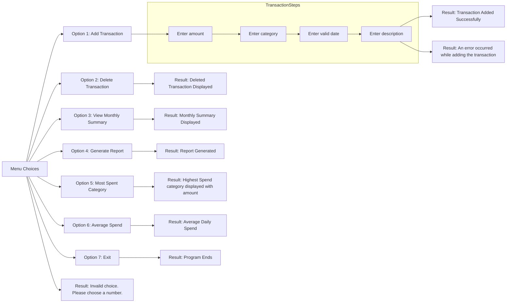

# CS50project Finance Tracker

## Figuring out what project to do

After some reading we considered doing a finance tracker which could 
- add or delete transactions and reliably save to a csv file
- provide a monthly summary of transactions giving the sum of 
transactions
- give specifics such as the average daily money spent in a given time period and the category which had the highest expenditure
- generate a graphical report for a given time period

My wife travelled abroad and I was left with the task of running the house and expenses. When she came back she was incensed at the amount of money I spent. I had only done the usual household expenses with nothing new. I realised that she was not really aware of how much a household with three boys can be costly. This was the inspiration for a finance tracker where a person can track their costs and a husband can prove to his skeptical wife that he had not wasted the money. 

## Steps

### Importing libraries

Before writing any code, we imported the libraries our program needs:

```python
import csv
import re
import pandas as pd
import matplotlib.pyplot as plt
import datetime
```

- `csv` – part of Python's standard library. We use it to write transactions to `finance_data.csv` with `csv.writer` and to read them back with `csv.reader`, so that our data is saved between uses of the program.
- `re` – Python's regular expression library, also built in. We use it to check that dates are entered in the YYYY-MM-DD format and months in the YYYY-MM format before we accept them.
- `pandas` (imported as `pd`) – a library for working with data in tables. We use it to turn our list of transactions into a DataFrame so that we can easily filter transactions by date, group them by category or by day, and add up or average the amounts.
- `matplotlib.pyplot` (imported as `plt`) – a library for drawing graphs. We use it in the `generate_report` method to draw a bar chart of spending by category and save it as `report.png`.
- `datetime` – built in. We use `strptime` to check that a date or month actually exists on the calendar and to turn text into real dates that can be compared, and `strftime` to turn dates back into friendlier words, such as "September 2026".

`csv`, `re` and `datetime` come with Python, so they do not need to be installed. The other libraries are listed in a file called `requirements.txt`:

```
pandas
matplotlib
pytest
```

We included `pytest` as well because we use it to run the tests in `test_project.py`. All three can be installed at once with:

```
pip install -r requirements.txt
```

### Creating classes
We utilized object oriented programming to set up two classes which we will use in the project

The first class we called Transaction with  attributes:
- amount
- category (type the transaction is attached to)
- date (on which the transaction was made)
- description (short description of the transaction)

```python
class Transaction:
    def __init__(self, amount, category, date, description=""):
        self.amount = float(amount)
        self.category = category
        self.date = date
        self.description = description
```

Then we set up the class FinanceTracker with several methods.  

```python
class FinanceTracker:
    def __init__(self, filename="finance_data.csv"):
        self.filename = filename
        self.transactions = []
```
- ``add transactions`` (which appends the list by adding a transaction)


``` python
def add_transaction(self, transaction):
        self.transactions.append(transaction)
```
- ``delete transactions`` uses a ``try/except`` block to remove a transaction from the transactions list using the ``pop()`` method and an index value. These index values are generated in a standalone delete_transaction_menu function (which I will talk about later) where the transactions are enumerated and displayed to the user.The removed transaction is stored in the variable ``deleted``, which allows the program to print the category, amount, date, and description of the deleted item so the user can verify that the correct transaction was removed. An error message is displayed if an invalid transaction number is entered.


> Later on in the main function. I have a menu of options one of which calls the `delete_transactions_menu` function which then calls the `delete_transaction` method. Initially we did not have deleting a transaction as one of the menu options Originally we had a save menu option which saved the file but I thought it would be better to build it into the adding a transaction menu option so that it would be done automatically. 

```python
def delete_transaction(self, index):
        try:
            deleted = self.transactions.pop(index)

            print(
                f"Deleted transaction: "
                f"{deleted.category} | "
                f"${deleted.amount:.2f} | "
                f"{deleted.date} | "
                f"{deleted.description}"
            )

        except IndexError:
            print("Invalid transaction number.")
```


- ``save_to_file`` (which instructs python to create the csv file if there was none present and saves the information
added)
  
```python
def save_to_file(self):
        with open(self.filename, "w", newline="") as file:
            writer = csv.writer(file)
            for t in self.transactions:
                writer.writerow([t.amount, t.category, t.date, t.description])
```

- ``load_from_file`` (which opens the file and reads the data that is present in it). If no file has been created we use the exception FileNotFoundError with the statement that "No existing file found. Starting fresh."

```python
def load_from_file(self):
        self.transactions = []  # Clear existing transactions before loading
        try:
            with open(self.filename, "r") as file:
                reader = csv.reader(file)
                for row in reader:
                    amount, category, date, description = row
                    self.transactions.append(
                        Transaction(float(amount), category, date, description)
                    )
        except FileNotFoundError:
            print("No existing file found. Starting fresh.")
```


- ``def generate_report`` - this method sums the total amount spent for each category over a specified requested time and then represent this on a graph. 

> [!NOTE]
> If there are no transactions, it will state no transactions to report


We set start_date and end_date to `None` to signify no limit. The menu in the `main()` function will turn a blank input into `None`. 

``` python
def generate_report(self, start_date=None, end_date=None):
        if not self.transactions:
            print("No transactions to report.")
            return
```
Then we used vars(t) to turn each transaction into a dictionary and then we used pandas to turn that list of dictionaries into a dataframe (table) with each transaction in a separate row. We also converted the date column from a string to real dates so that Python can compare them. 

```python
        df = pd.DataFrame([vars(t) for t in self.transactions])
        df["date"] = pd.to_datetime(df["date"])  # convert to datetime
```
We used two `IF` statements to handle start and end dates. We set the start date to match transactions with date values on or after the input date. For a given end date we specified values before or on the input date.  

```python
        if start_date:
            start_date = datetime.datetime.strptime(start_date, "%Y-%m-%d")
            df = df[df["date"] >= start_date]
        if end_date:
            end_date = datetime.datetime.strptime(end_date, "%Y-%m-%d")
            df = df[df["date"] <= end_date]
```
If the dataframe was empty then a message *"No transactions in this period."* was given and returns to the main menu. 
```python
        if df.empty:
            print("No transactions in this period.")
            return
```

We then grouped the rows by categories and then added the amounts in each group using the command `.sum()`

```python
        totals = df.groupby("category")["amount"].sum()
        print(totals)
```

We then plotted the transaction category totals in a bar chart with one bar per category saving it as a png file in a file called **report.png**
```python
        totals.plot(kind="bar", title="Spending by Category")
        plt.ylabel("Amount ($)")
        plt.savefig("report.png")
        plt.show()
```
> [!Note] We did not check the dates in this method because we used the `validate_date` function below to check the dates in the menu in the `main()` function. This is because `generate_report` is only called from the menu. 

### We then defined several standalone functions 
-   `def validate_date` - In this function, we create a regular expression (regex) to ensure that the date is entered in the YYYY-MM-DD format. We then use a try/except block together with the datetime.strptime() method to verify that the input is a valid calendar date. If the date is not in the correct format or does not exist on the calendar, a ValueError is raised with an appropriate error message, which is printed where the function is called. The user is then prompted to enter a correct date, and once it is correct the function returns the validated date string.


```python
def validate_date(date_str):
    pattern = r"^\d{4}-\d{2}-\d{2}$"

    if not re.match(pattern, date_str):
        raise ValueError("Date must be in YYYY-MM-DD format")

    try:
        datetime.datetime.strptime(date_str, "%Y-%m-%d")
    except ValueError:
        raise ValueError("Date is not a valid calendar date")

    return date_str

```
- `def delete_transaction_menu` - Then we set up a delete_transaction_menu function. If there are no transactions in the tracker, we use an if not statement to print the message "No transactions available" and exit the function.
We then created a while loop with several conditionals. An if statement allows the user to leave the function at any time by typing "esc". Instead of displaying every transaction in the tracker, we decided to allow the user to first select a month and then display only the transactions from that month.
Firstly, we created a regular expression (regex) to constrain the year-month input to the YYYY-MM format. We then used a try/except block together with the strptime() method from the datetime.datetime class to ensure that a valid month was entered. We then used strftime() to convert the year and month into words and stored the result in the variable month_name. We do this because it provides friendlier output for the user. For example, 2028-08 is displayed as "August 2028". Invalid inputs are handled using a ValueError exception and an error message.

```python
def delete_transaction_menu(tracker):

    if not tracker.transactions:
        print("No transactions available.")
        return

    while True:

        month = input(
            "Enter month (YYYY-MM) or type 'esc' to return: "
        )

        if month.lower() == "esc":
            return

        pattern = r"^\d{4}-\d{2}$"

        if not re.match(pattern, month):
            print(
                "❌ Invalid month format. "
                "Please use YYYY-MM (e.g., 2026-09)."
            )
            continue

        try:
            dt = datetime.datetime.strptime(month, "%Y-%m")
            month_name = dt.strftime("%B %Y")
            break

        except ValueError:
            print(
                "❌ Invalid month. "
                "Please enter a valid month."
            )

```   

We then set up an empty list called matches. For every transaction whose date starts with the selected month, we use the append() method to add a tuple containing the transaction and its original index position to the matches list. An if not statement is used to display a message if no transactions are found for the selected month. The matches list therefore contains only the transactions from the selected month together with their original index positions in the main transactions list.
We wanted the displayed transaction numbers to start from 0, so we used another for loop with enumerate() to create a new variable called display_index. We then used an f-string to display display_index together with the transaction details. This gives the user a simple numbering system for selecting which transaction should be deleted while still allowing the program to keep track of the original transaction indexes needed for deletion.

```python
    matches = []

    for real_index, transaction in enumerate(tracker.transactions):

        if transaction.date.startswith(month):

            matches.append(
                (real_index, transaction)
            )

    if not matches:
        print(f"No transactions found for {month_name}.")
        return

    print(f"\nTransactions for {month_name}\n")

    for display_index, (real_index, transaction) in enumerate(matches):

        print(
            f"{display_index}: "
            f"{transaction.category} | "
            f"${transaction.amount:.2f} | "
            f"{transaction.date} | "
            f"{transaction.description}"
        )
    while True:

        try:

            delete_choice = int(
                input(
                    "\nEnter transaction number to delete "
                    "or -1 to cancel: "
                )
            )

            if delete_choice == -1:
                return

            if (
                delete_choice < 0
                or delete_choice >= len(matches)
            ):
                print("Invalid transaction number.")
                continue

            real_index = matches[delete_choice][0]

```

To make the application feel more realistic, we added a confirmation step before deletion. A while loop and a try/except block are used to repeatedly prompt the user for a transaction number. The variable delete_choice stores the user's selection or allows the user to cancel the operation. If the user enters -1, the function returns to the main menu. If the user enters a transaction number that does not exist, an if statement with the or operator detects the invalid input, displays the message "Invalid transaction number", and the continue statement returns execution to the start of the loop so that the user can try again.

``` python
 confirm = input(
                "Are you sure you want to delete "
                "this transaction? (y/n): "
            )

            if confirm.lower() == "y":

                tracker.delete_transaction(real_index)

                tracker.save_to_file()

                print(
                    "Transaction deleted successfully!"
                )

            else:
                print("Deletion cancelled.")

            return

        except ValueError:
            print("Please enter a valid number.")
```

- `def monthly_summary` - this function prompts the user to enter a specific month as input, then calculates the total amount of money spent for the month and displays a statement showing how much money was spent during that month. It also gives an alert if spending exceeds a preset threshold. We use the same block of code used at the beginning of the `delete_transaction_menu` function where we validate the input using a regex in the format YYYY-MM, then use datetime to test for a valid month and convert the date into words, storing it in a variable called month_name. In a variable called total, we store the sum of all transactions for the selected month. We then use an if statement to determine if the total exceeds a preset value of $100,000, which triggers an alert message.

```python
def monthly_summary(transactions):
    while True:
        month = input("Enter month (YYYY-MM) or type 'esc' to return: ")

        if month.lower() == "esc":
            return

        pattern = r"^\d{4}-\d{2}$"
        if not re.match(pattern, month):
            print("❌ Invalid month format. Please use YYYY-MM (e.g., 2026-09).")
            continue

        try:
            dt = datetime.datetime.strptime(month, "%Y-%m")
            month_name = dt.strftime("%B %Y")
            break
        except ValueError:
            print("❌ Invalid month format. Please use YYYY-MM (e.g., 2026-09).")
            continue

    total = sum(t.amount for t in transactions if t.date.startswith(month))
    if total > 100000:
        print(f"⚠️ Alert: You spent over $100,000 in {month_name}!")
    print(f"Total spent in {month_name}: ${total:.2f}")
```   

-   `def most_spent_category` - this function totals all transactions by category and identifies the category which carried the most expenditure. 

> If there are not transactions it prints"No Transactions available."

```python
def most_spent_category(transactions):
    if not transactions:
        print("No transactions available.")
        return
    df = pd.DataFrame([vars(t) for t in transactions])
    totals = df.groupby("category")["amount"].sum()
    max_category = totals.idxmax()
    max_value = totals.max()
    print(f"💰 Most spent on: {max_category} (${max_value:.2f})")
```  

- `def average_daily_spend` - this function is supposed to give the average spent per day over a given period. This utilises optional start and end date entries. The code at the beginning is similar to previous sections with a printout if there are no transactions. A dataframe of the transactions is created using pandas and the date column is converted from a string to real dates. 

```python
def average_daily_spend(transactions):
    if not transactions:
        print("No transactions available.")
        return

    df = pd.DataFrame([vars(t) for t in transactions])
    df["date"] = pd.to_datetime(df["date"])
```
We then used a `while` loop with a `try/except` block to check the dates. WE made allowance if the user wanted to exit and return to the main menu at any time by typing **esc**. The function validate_date was used to validate all date entries within the `try/except` block and a `ValueError` statement was printed if the wrong date entry was given. 

```python
# ✅ Prompt for start date
    while True:
        start = input("Enter start date (YYYY-MM-DD), press enter to leave blank, or type 'esc' to return to the main menu: ")
        if start.lower() == "esc":
            return
        if not start.strip():
            start = None
            break
        try:
            start = validate_date(start)
            start = datetime.datetime.strptime(start, "%Y-%m-%d")
            break
        except ValueError as e:
            print(f"❌ {e}. Please try again.")

    # ✅ Prompt for end date
    while True:
        end = input("Enter end date (YYYY-MM-DD), press enter to leave blank, or type 'esc' to return to the main menu: ")
        if end.lower() == "esc":
            return
        if not end.strip():
            end = None
            break
        try:
            end = validate_date(end)
            end = datetime.datetime.strptime(end, "%Y-%m-%d")
            break
        except ValueError as e:
            print(f"❌ {e}. Please try again.")


```
If start or end dates are given then we filtered a range to include dates on or after the start date and on or before the end date. If there are no transactions in the range a statement is printed. We then group the rows by by day, and the amounts for each day are added up.We then stored it in a variable called daily_totals. Then we find the average of those daily totals and store it in a variable called avg_spend. Only days that have transactions are counted. Days with no spending are not included as $0, so the result is the average per spending day, not per calendar day.

```python
if start:
        df = df[df["date"] >= start]
    if end:
        df = df[df["date"] <= end]

    if df.empty:
        print("No transactions in this period.")
        return

    daily_totals = df.groupby(df["date"].dt.date)["amount"].sum()
    avg_spend = daily_totals.mean()
```
We then use a set of `if` and `elif` statements to account for different scenarios whether a start or end date was given or not given. Because we wanted to use words as much as possible in our presentation we converted the dates to words using `strftime` from the datetime library and stored it in the variable period. Then we printed the average daily spend.

```python
if start and end:
        period = f"between {start.strftime('%B %d, %Y')} and {end.strftime('%B %d, %Y')}"
    elif start and not end:
        period = f"from {start.strftime('%B %d, %Y')} onward"
    elif end and not start:
        period = f"up to {end.strftime('%B %d, %Y')}"
    else:
        period = "across all recorded transaction periods"

    print(f"📆 Average daily spend {period}: ${avg_spend:.2f}")
```


## Setting up of the main function 

This includes all we planned to do in the expense tracker program. In our `main()` function we create the object `tracker` from the class `Financetracker`. We then called its method `load_from_file()` to access existing information from the csv file. 

```python
def main():
    tracker = FinanceTracker()
    tracker.load_from_file()
```

We then instructed the program to print the different options for the expense tracker and prompt the user for a choice. 

``` python
 while True:
        print("\n--- Personal Finance Tracker ---")
        print("1. Add Transaction")
        print("2. Delete Transaction")
        print("3. View Monthly Summary")
        print("4. Generate Report")
        print("5. Most Spent Category")
        print("6. Average Daily Spend")
        print("7. Exit")

        choice = input("Choose an option: ")
```

We then use conditional `if` statements to determine the result that will happen given the option chosen. For choice 1: adding a transaction, we set up an outer `try/except` block that holds two `while` loops, each with its own `try/except` block. We set the conditions for the transaction including: the amount must be non-negative; it must be numeric (or else a ValueError catches it and a statement is printed and the user is asked again). The category is stripped of white spaces at the start and end and made lower case to prevent two different categories being created which were the same. (We had an issue when we entered "food" and "Food".) The date was tested using validate_date, and the user is asked again until a valid date is entered. The description is optional. The methods add_transaction and save_to_file were called and the statement "Transaction added successfully!" was printed. The outer `try/except` catches anything unexpected, for example if the file could not be saved, and prints an error message instead of the program crashing.  

```python
if choice == "1":
            try:
                while True:
                    try:
                        amount = float(input("Enter amount: "))
                        if amount < 0:
                            print(
                                "Amount cannot be negative. Please enter a valid amount."
                            )
                            continue
                        break
                    except ValueError:
                        print(
                            "Invalid input. Please enter a numeric value for the amount."
                        )

                category = input("Enter category (Food, Rent, etc.): ").strip().lower()
                while True:
                    try:
                        date = validate_date(
                            input("Enter date (YYYY-MM-DD): ")
                        )
                        break
                    except ValueError as e:
                        print(f"❌ {e}")
                description = input("Enter description (optional): ")
                tracker.add_transaction(
                    Transaction(amount, category, date, description)
                )
                tracker.save_to_file()  # Save after adding a transaction
                print("Transaction added successfully!")
            except Exception as e:
                print(f"An error occurred while adding the transaction: {e}")
```

We then called the functions for `delete_transaction_menu` and for `monthly_summary` for choices 2 & 3. 

```python
        elif choice == "2":
            delete_transaction_menu(tracker)

        elif choice == "3":
            monthly_summary(tracker.transactions)
```
For choice 4 we set up two `while` loops for the start and end dates, each with `try/except` blocks. The inputs for start and end dates are set to `NONE` if there is no entry. The dates are validated using the validate_date function. 
```python
        elif choice == "4":
            print("Generate report for a period.")

            # ✅ Keep prompting until valid start date
            while True:
                start = input("Enter start date (YYYY-MM-DD) or press enter to leave blank: ")
                if not start.strip():
                    start = None
                    break
                try:
                    start = validate_date(start)  # strict regex check
                    break  # valid, exit loop
                except ValueError as e:
                    print(f"❌ {e}. Please enter a proper start date.")

            # ✅ Keep prompting until valid end date
            while True:
                end = input("Enter end date (YYYY-MM-DD) or press enter to leave blank: ")
                if not end.strip():
                    end = None
                    break
                try:
                    end = validate_date(end)
                    break  # valid, exit loop
                except ValueError as e:
                    print(f"❌ {e}. Please enter a proper end date.")

            tracker.generate_report(start_date=start, end_date=end)
```
We then called the functions for `most_spent_category`, `average_daily_spend` for choices 5 and 6. Option 7 was for exiting, with a print statement if an invalid choice is chosen. 

```python

        elif choice == "5":
            most_spent_category(tracker.transactions)

        elif choice == "6":
            average_daily_spend(tracker.transactions)

        elif choice == "7":
            print("Goodbye!")
            break

        else:
            print("Invalid choice. Please choose a number.")
```
This is represented in the following flowchart.   



** We then worked on our pytests. I did pytests for all the standalone functions. I realised that I would need a sample of inputs to test functions. I used the data that I had created while setting up and testing `project.py` 

## Testing with pytest

To check that our standalone functions work correctly, we wrote tests in a separate file called `test_project.py`, which we run with the command `pytest test_project.py`. We decided to test the five standalone functions: `delete_transaction_menu`, `monthly_summary`, `most_spent_category`, `validate_date` and `average_daily_spend`.

### Imports

We imported `pytest` and then imported the five functions from `project.py`. We also imported the two classes, `FinanceTracker` and `Transaction`. We are not testing the classes themselves, but we need them to build the sample data: `delete_transaction_menu` needs a real tracker object because it calls the tracker's `delete_transaction` and `save_to_file` methods, and the other functions need a list of `Transaction` objects so they can read each transaction's amount, date and category.

```python
import pytest
from project import (
    delete_transaction_menu,
    monthly_summary,
    most_spent_category,
    validate_date,
    average_daily_spend,
    FinanceTracker,  # only used to load the sample data for the tests
    Transaction,
)
```

### Sample data

We stored a fixed copy of our transaction data in a variable called `SAMPLE_CSV` in the test file instead of using our real `finance_data.csv`. We did this for two reasons. First, the real file changes every time we add or delete a transaction, which would change the totals and make the tests fail even when the code is correct. Second, some of the tests delete transactions, and we did not want the tests to remove our real data. We chose data that spread over several months, included a month over the $100,000 alert limit, and included one day (2026-10-14) with two transactions, so that we could test many different situations.

```
SAMPLE_CSV = """\
800.0,food,2026-08-04,nice
3500.0,stationary,2026-09-10,For school
60000.0,food,2026-09-01,Food affi eat
4500.0,physics book,2026-09-12,physics hard
30000.0,extra classes,2026-09-14,i want my weekends
16000.0,clothing,2026-09-15,nice shoes!
14000.0,entertainment,2026-09-17,nice movies
23500.0,supplies,2026-09-20,project
800.0,food,2026-10-04,nice
3500.0,stationary,2026-10-10,For school
60000.0,food,2026-10-01,Food affi eat
4500.0,physics book,2026-10-12,physics hard
30000.0,extra classes,2026-10-14,i want my weekends
16000.0,clothing,2026-10-15,nice shoes!
14000.0,entertainment,2026-10-17,nice movies
23500.0,supplies,2026-10-20,project
800.0,food,2026-11-04,nice
3500.0,stationary,2026-11-10,For school
60000.0,food,2026-11-01,Food affi eat
4500.0,physics book,2026-11-12,physics hard
30000.0,extra classes,2026-11-14,i want my weekends
16000.0,clothing,2026-11-15,nice shoes!
14000.0,entertainment,2026-12-17,nice movies
23500.0,supplies,2026-12-20,project
16000.0,pharmacy,2026-12-21,pills cost
30000.0,appliances,2026-08-23,need microwave
16000.0,pharmacy,2026-12-14,pills cost
1500.0,personal,2026-08-27,Got a trim
36000.0,food,2026-08-15,supermarket
8600.0,personal,2026-08-14,Bought a watch
25000.0,csec fees,2026-10-14,For the boys
70000.0,rent,2026-07-15,We haffi live somewhere
"""
```

### Simulating user input

Most of our functions use `input()` to ask the user questions, but a test cannot type answers. We wrote a helper function called `dummy_inputs` that uses pytest's `monkeypatch` to replace Python's `input()` with our own version for the length of a test. We give it a list of answers, and each time the function asks a question, `next()` hands over the next answer in the list. For example, `["2026-07", "0", "y"]` answers the month, the transaction number and the confirmation *yes* in `delete_transaction_menu`.

```python
def fake_inputs(monkeypatch, answers):
    answers = iter(answers)
    monkeypatch.setattr("builtins.input", lambda _prompt="": next(answers))
```

### The tracker fixture

Many of our tests needed the same sample data, so instead of repeating the setup in every test we created a pytest fixture called `tracking`. It uses pytest's `tmp_path` (a temporary folder that is deleted after the test) to write `SAMPLE_CSV` to a test file, creates a `FinanceTracker` that saves to that file, and loads the data using our `load_from_file` method. Any test that has `tracking` in its brackets automatically receives a fresh copy, so a transaction deleted in one test is still there in the next.

```python
@pytest.fixture
def tracking(tmp_path):
    csv_file = tmp_path / "test_data.csv"
    csv_file.write_text(SAMPLE_CSV)
    t = FinanceTracker(filename=csv_file)
    t.load_from_file()
    return t
```

We also used pytest's `capsys`, which captures everything a function prints. Because our functions print their results rather than returning them, we use `capsys.readouterr().out` to get the printed text and then use `assert` to check that the expected message appears.


We know our sample has 32 transactions. Our first test was to check that the sample data had loaded correctly by asserting that the `tracking` fixture has 32 transactions. We then gave the dummy inputs `["2026-07", "0", "y"]` to our code, telling it the month was July 2026, our transaction number was 0, and our answer to whether we wanted to delete it was yes. Note: we did this because July has only one transaction, and it is the only month which has a transaction with the category `rent` in the sample. Then we checked that the number of transactions in the tracker had changed to 31, and we checked that `rent` was no longer in the transaction categories, because if it was still there, the transaction we chose had not been deleted. We also checked that the message `Transaction deleted successfully!` was printed, using `capsys`.

```python

def test_delete_transaction_menu(tracking, monkeypatch, capsys):
    # Check the sample data loaded correctly before deleting anything
    assert len(tracking.transactions) == 32

    # July has one transaction (rent): pick number 0 and confirm with y
    dummy_inputs(monkeypatch, ["2026-07", "0", "y"])
    delete_transaction_menu(tracking)

    assert len(tracking.transactions) == 31  # one was deleted
    assert all(t.category != "rent" for t in tracking.transactions)
    assert "Transaction deleted successfully!" in capsys.readouterr().out
```
We also tested to see if there was a correct index display number matching with the index number deleted. We also checked to see if the delete was saved and whether a cancellation was correctly checked. 

| Test | Inputs | What it checks |
|---|---|---|
| `test_delete_transaction_menu_deletes_correct_one` | December, 3, y | The display number deletes the right transaction in the full list |
| `test_delete_transaction_menu_saves_to_file` | July, 0, y | The deletion is saved to the CSV file |
| `test_delete_transaction_menu_cancel` | September, 0, n | Nothing deleted, "Deletion cancelled." printed |

```python
 dummy_inputs(monkeypatch, ["2026-12", "3", "y"])
    delete_transaction_menu(tracking)
    dates = [t.date for t in tracking.transactions]
    assert "2026-12-14" not in dates
    assert "2026-12-21" in dates  # the other pharmacy entry is still there
    assert "2026-08-23" in dates  # appliances was not touched
```


