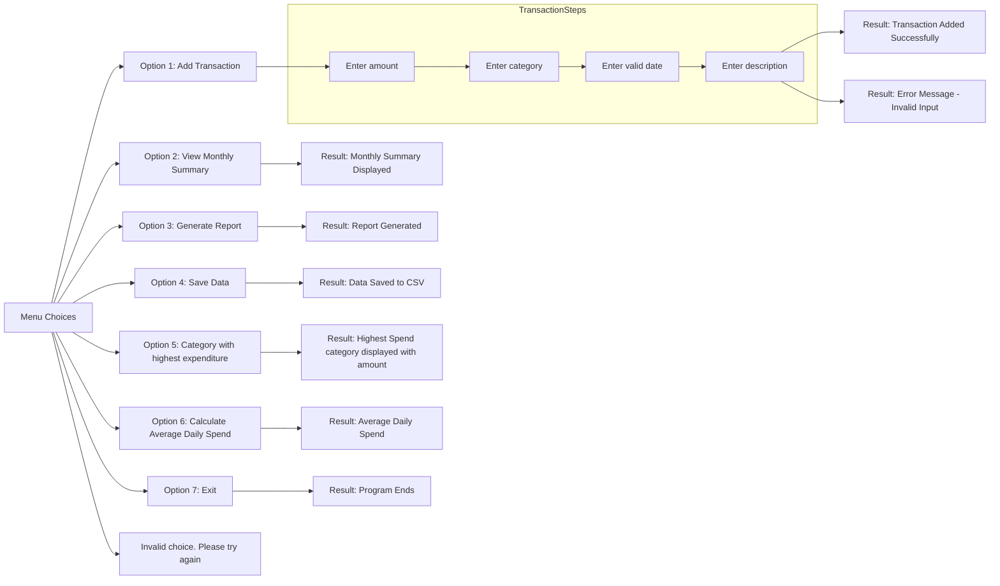
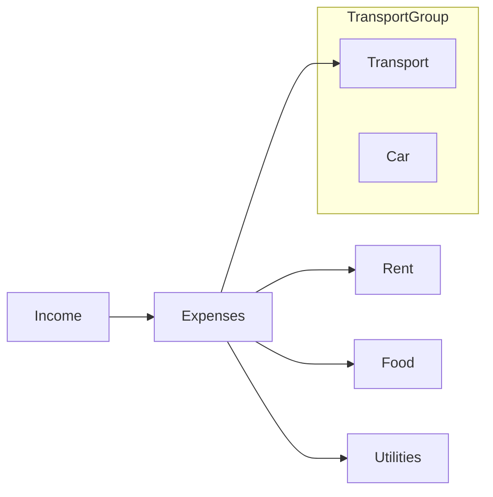
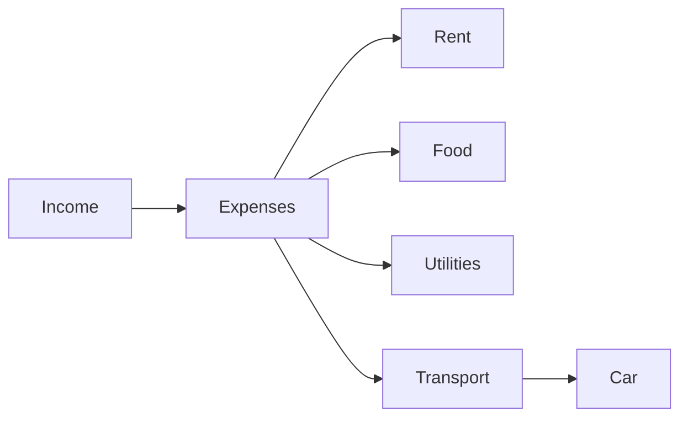

# CS50project Finance Tracker

## Figuring out what project to do

After some reading we considered doing a finance tracker which could 
- add or delete transactions and reliably save to a csv file
- provide a monthly summary of transactions giving the sum of 
transactions
- give specifics such as the average daily money spent in a given time period and the category which had the highest expenditure
- generate a graphical report for a given time period

## Steps

### Creating classes
We utilized object oriented programming to set up two classes which we will use in the project

The first class we called Transaction with  attributes:
- amount
- category (type the transaction is attached to)
- date (on which the transaction was made)
- description (short description of the transaction)

```python
class Transaction:
    def __init__(self, amount, category, date, description=""):
        self.amount = amount
        self.category = category
        self.date = date
        self.description = description
```

Them we set up the class FinanceTracker with several methods.  

```python
class FinanceTracker:
    def __init__(self, filename="finance_data.csv"):
        self.filename = filename
        self.transactions = []
```
- ``add transactions`` (which appends the file by adding transactions)
  
``` python
def add_transaction(self, transaction):
        self.transactions.append(transaction)
```
- ``delete transactions`` uses a ``try/except`` block to remove a transaction from the transactions list using the ``pop()`` method and an index value. These index values are generated in a standalone delete_transaction_menu function (which I will talk about later) where the transactions are enumerated and displayed to the user.The removed transaction is stored in the variable ``deleted``, which allows the program to print the category, amount, date, and description of the deleted item so the user can verify that the correct transaction was removed. An error message is displayed if an invalid transaction number is entered.

```python
def delete_transaction(self, index):
        try:
            deleted = self.transactions.pop(index)

            print(
                f"Deleted transaction: "
                f"{deleted.category} | "
                f"${deleted.amount:.2f} | "
                f"{deleted.date} | "
                f"{deleted.description}"
            )

        except IndexError:
            print("Invalid transaction number.")
```


- ``save_to_file`` (which instructs python to create the csv file if there was none present and saves the information
  added)
  
```python
def save_to_file(self):
        with open(self.filename, "w", newline="") as file:
            writer = csv.writer(file)
            for t in self.transactions:
                writer.writerow([t.amount, t.category, t.date, t.description])
```

- ``load_from file`` (which opens the file and reads the data that is present in it). If no file has been created we use the exception FileNotFoundError with the statement that the "file was not found. Starting Fresh"

```python m
def load_from_file(self):
        try:
            with open(self.filename, "r") as file:
                reader = csv.reader(file)
                for row in reader:
                    amount, category, date, description = row
                    self.transactions.append(Transaction(float(amount), category, date, description))
        except FileNotFoundError:
            print("No existing file found. Starting fresh.")
```


- ``def generate_report`` - this function sums the total amount spent for each category over a specified requested time and then represents this on a graph. 
> [!IMPORTANT]
>```
>    If there are no transactions, it will state no transactions to report
>```


``` python
def generate_report(self):
        if not self.transactions:
            print("No transactions to report.")
            return
        df = pd.DataFrame([vars(t) for t in self.transactions])
        print(df.groupby("category")["amount"].sum())
        df.groupby("category")["amount"].sum().plot(kind="bar")
        plt.show()
```

### We then defined several standalone functions 
-   `def validate_date` - In this function, we create a regular expression (regex) to ensure that the date is entered in the YYYY-MM-DD format. We then use a try/except block together with the datetime.strptime() method to verify that the input is a valid calendar date. If the date is not in the correct format or does not exist on the calendar, a ValueError is raised and an appropriate error message is displayed. The function then returns the validated date string.


```python
def validate_date(date_str):
    pattern = r"^\d{4}-\d{2}-\d{2}$"

    if not re.match(pattern, date_str):
        raise ValueError("Date must be in YYYY-MM-DD format")

    try:
        datetime.datetime.strptime(date_str, "%Y-%m-%d")
    except ValueError:
        raise ValueError("Date is not a valid calendar date")

    return date_str

```
- `def delete_transaction_menu` - Then we set up a delete_transaction_menu function. If there are no transactions in the tracker, we use an if not statement to print the message "No transactions available" and exit the function.
We then created a while loop with several conditionals. An if statement allows the user to leave the function at any time by typing "esc". Instead of displaying every transaction in the tracker, we decided to allow the user to first select a month and then display only the transactions from that month.
Firstly, we created a regular expression (regex) to constrain the year-month input to the YYYY-MM format. We then used a try/except block together with the strptime() method from the datetime.datetime class to ensure that a valid month was entered. We then used strftime() to convert the year and month into words and stored the result in the variable month_name. We do this because it provides friendlier output for the user. For example, 2028-08 is displayed as "August 2028". Invalid inputs are handled using a ValueError exception and an error message.

```python
def delete_transaction_menu(tracker):

    if not tracker.transactions:
        print("No transactions available.")
        return

    while True:

        month = input(
            "Enter month (YYYY-MM) or type 'esc' to return: "
        )

        if month.lower() == "esc":
            return

        pattern = r"^\d{4}-\d{2}$"

        if not re.match(pattern, month):
            print(
                "❌ Invalid month format. "
                "Please use YYYY-MM (e.g., 2026-09)."
            )
            continue

        try:
            dt = datetime.datetime.strptime(month, "%Y-%m")
            month_name = dt.strftime("%B %Y")
            break

        except ValueError:
            print(
                "❌ Invalid month. "
                "Please enter a valid month."
            )

```   

We then set up an empty list called matches. For every transaction whose date starts with the selected month, we use the append() method to add a tuple containing the transaction and its original index position to the matches list. An if not statement is used to display a message if no transactions are found for the selected month. The matches list therefore contains only the transactions from the selected month together with their original index positions in the main transactions list.
We wanted the displayed transaction numbers to start from 0, so we used another for loop with enumerate() to create a new variable called display_index. We then used an f-string to display display_index together with the transaction details. This gives the user a simple numbering system for selecting which transaction should be deleted while still allowing the program to keep track of the original transaction indexes needed for deletion.

```python
    matches = []

    for real_index, transaction in enumerate(tracker.transactions):

        if transaction.date.startswith(month):

            matches.append(
                (real_index, transaction)
            )

    if not matches:
        print(f"No transactions found for {month_name}.")
        return

    print(f"\nTransactions for {month_name}\n")

    for display_index, (real_index, transaction) in enumerate(matches):

        print(
            f"{display_index}: "
            f"{transaction.category} | "
            f"${transaction.amount:.2f} | "
            f"{transaction.date} | "
            f"{transaction.description}"
        )
    print(len(matches))
    while True:

        try:

            delete_choice = int(
                input(
                    "\nEnter transaction number to delete "
                    "or -1 to cancel: "
                )
            )

            if delete_choice == -1:
                return

            if (
                delete_choice < 0
                or delete_choice >= len(matches)
            ):
                print("Invalid transaction number.")
                continue

            real_index = matches[delete_choice][0]

```

To make the application feel more realistic, we added a confirmation step before deletion. A while loop and a try/except block are used to repeatedly prompt the user for a transaction number. The variable delete_choice stores the user's selection or allows the user to cancel the operation. If the user enters -1, the function returns to the main menu. If the user enters a transaction number that does not exist, an if statement with the or operator detects the invalid input, displays the message "Invalid transaction number", and the continue statement returns execution to the start of the loop so that the user can try again.

``` python
 confirm = input(
                "Are you sure you want to delete "
                "this transaction? (y/n): "
            )

            if confirm.lower() == "y":

                tracker.delete_transaction(real_index)

                tracker.save_to_file()

                print(
                    "Transaction deleted successfully!"
                )

            else:
                print("Deletion cancelled.")

            return

        except ValueError:
            print("Please enter a valid number.")
```

- ``def monthly_summary``  - this function calculates the total amount of money spent for the month and returns that in a string statement telling how much money a person earned over the month and also gives an alert if it went over that amount. We also used a ``Try/except`` block of code to make the month name in words to make it more friendly. I used the datetime library and imported the class datetime to use strptime to convert the string input into a a datetime format, then I converted the format to words using strftime to change from the year month format into a string with the words. We had a ``ValueError``exception with an error statement and the ``return`` at the end of the ``Try`` block made the function keep prompting until the correct input is put in. 
 


 ```python
def monthly_summary(self, month):
        try:
        dt = datetime.datetime.strptime(month, "%Y-%m") 
        month_name = dt.strftime("%B %Y")
    except ValueError:
        print("❌ Invalid month format. Please use YYYY-MM (e.g., 2026-09).")
        return

    total = sum(t.amount for t in transactions if t.date.startswith(month))
    if total > 1000:
        print(f"⚠️ Alert: You spent over $1000 in {month_name}!")
    print(f"Total spent in {month_name}: ${total:.2f}")

```   

-   
    - `def_most_spent_category` - this function totals the amount spent in a month and identifies the category which carried the most expenditure.  

```python
def most_spent_category(transactions):
    if not transactions:
        print("No transactions available.")
        return
    df = pd.DataFrame([vars(t) for t in transactions])
    totals = df.groupby("category")["amount"].sum()
    max_category = totals.idxmax()
    max_value = totals.max()
    print(f"💰 Most spent on: {max_category} (${max_value:.2f})")
```  

-   
    - `def average_daily_spend` - this function gives the average daily spend for the month

```python
def average_daily_spend(transactions):
    if not transactions:
        print("No transactions available.")
        return
    df = pd.DataFrame([vars(t) for t in transactions])
    df["date"] = pd.to_datetime(df["date"])
    daily_totals = df.groupby(df["date"].dt.date)["amount"].sum()
    avg_spend = daily_totals.mean()
    print(f"📆 Average daily spend: ${avg_spend:.2f}")
```


## Setting up of the main function 

This includes all we planned to do in the expense tracker program. In our `main()` function we create the object `tracker` from the class finance tracker. We then called its method `load_from_file()` to access existing information from the csv file. 

```python
def main():
    tracker = FinanceTracker()
    tracker.load_from_file()
```

We then instructed the program to print the different options for the expense tracker and prompt the user for a choice. 

``` python
while True:
    print("\n--- Personal Finance Tracker ---")
    print("1. Add Transaction")
    print("2. View Monthly Summary")
    print("3. Generate Report")
    print("4. Save Data")
    print("5. Most Spent Category")
    print("6. Average Daily Spend")
    print("7. Exit")

    choice = input("Choose an option: ")
```

We then use use conditional IF sentences to determine the result that will happen given the option chosen. 

```python
if choice == "1":
            try:
                while True:
                    try:
                        amount = float(input("Enter amount: "))
                        if amount < 0:
                            print("Amount cannot be negative. Please enter a valid amount.")
                            continue
                        break
                    except ValueError:
                        print("Invalid input. Please enter a numeric value for the amount.")

                category = input("Enter category (Food, Rent, etc.): ")
                date = validate_date(input("Enter date (YYYY-MM-DD): "))
                description = input("Enter description (optional): ")
                tracker.add_transaction(Transaction(amount, category, date, description))
                print("Transaction added successfully!")
            except Exception as e:
                print(f"An error occurred while adding the transaction: {e}")

        elif choice == "2":
            month = input("Enter month (YYYY-MM): ")
            monthly_summary(tracker.transactions, month)

        elif choice == "3":
            tracker.generate_report()

        elif choice == "4":
            tracker.save_to_file()
            print("Data saved successfully!")

        elif choice == "5":
            most_spent_category(tracker.transactions)

        elif choice == "6":
            average_daily_spend(tracker.transactions)

        elif choice == "7":
            print("Goodbye!")
            break


        else:
            print("Invalid choice. Please choose a number.")
```
This is represented in the following flowchart.   

Average Daily Spend
    [Result: Highest Spend category displayed with amount]




[Can we have a link here](https://www.google.com/search?q=picture+of+a+dog&rlz=1C1CFYW_enJM1210JM1210&oq=picture+of+a+dog&gs_lcrp=EgZjaHJvbWUqBggAEEUYOzIGCAAQRRg7MgcIARAAGIAEMgcIAhAAGIAEMgcIAxAAGIAEMgcIBBAAGIAEMgcIBRAAGIAEMgcIBhAAGIAEMgcIBxAAGIAEMgcICBAAGIAEMgcICRAAGIAE0gEINDE2NWowajeoAgCwAgA&sourceid=chrome&source=chrome.ob&ie=UTF-8#sv=CAMSXhoyKhBlLWR4VEJsb01XQloweENNMg5keFRCbG9NV0JaMHhDTToOSlhSb2p1RVVxYklFWE0gBCokCg41ODNmcmdyZHE2aVlGTRIQZS1keFRCbG9NV0JaMHhDTRgAMAEYByCBlczqCEoIEAEYASABKAE)


This is being done *in a crazy* way to **TEST**


## Expense Tracker
This section shows a sample record of expenses stored in table format.


| 🟦 Category | 🟦 Details | 🟦 Status |
| --- | --- | --- |
| rent| 50 | 2026-09-14 |
> 💡 Tip: You can add more rows for additional expenses.

## Sample of Expense Flowchart




Below we have some blocked text
> This text is indented 

## Sample 2 of Expense Flowchart



> [!NOTE]
> This is a general note.

> [!TIP]
> 💡 Helpful hint goes here.

> [!IMPORTANT]
> ⚠️ Critical instruction you must follow.

> [!WARNING]
> 🚨 Be careful — this could cause issues.

A polished README often mixes tables, flowcharts, and callouts. For example, you could put your expense table, then add a [!IMPORTANT]

>```
>    I love the work I am doing
>```


In this script we have some `Variable` and `string` values

If we want to bold and underline we can use this
## Trust the Process

In this script we have some `Variable` and `string` values


- first time

links for videos to learn from include

[learning github](https://www.youtube.com/watch?v=eJojC3lSkwg)

[making a gihub rpository](https://www.youtube.com/watch?v=qNKdm8qAQfg) 

